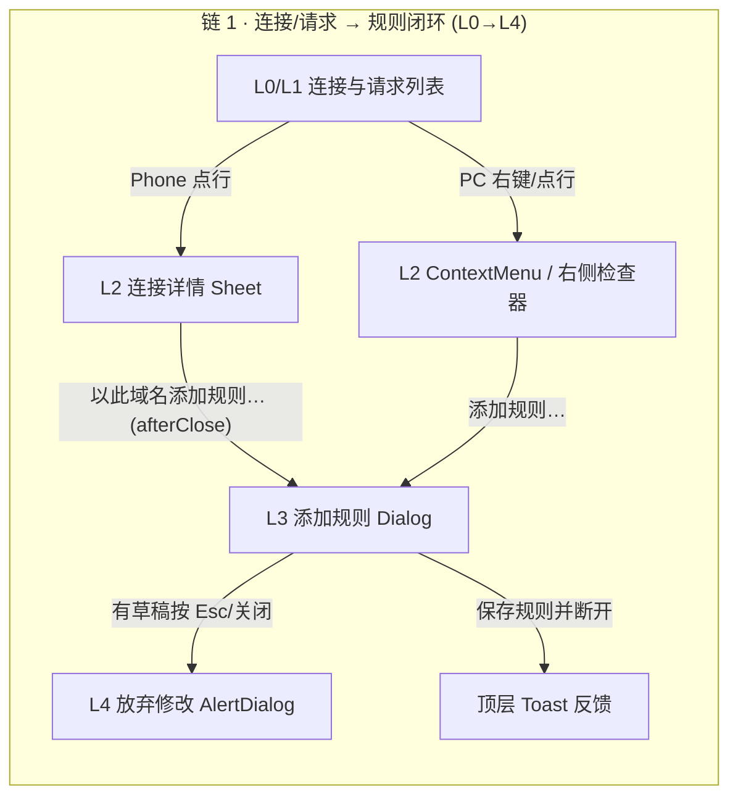

# Paws 三端 UI 设计规范（NSH Design Guides 完整对齐版）

> **状态**：设计稿待审计（尚未改动 `ui/nsh/src/` 生产代码）  
> **配套可视化交互设计稿**：[paws-nsh-design.html](./paws-nsh-design.html)（含可点击的 Phone / Pad / PC 多级交互原型台 + 全景审阅画板）  
> **规范依据**：
> - `nsh/skills/nsh-design-guides/references/design-guides.md`（NSH 规范性设计指南）
> - `nsh/examples/nsh-gallery-ui`（NSH Gallery UI 令牌、双档尺寸、表面材质与动效基准）
> - `docs/nsh-three-layer-architecture.md`（Paws 三层架构、14  typed domains、修订冲突与 VPN 会话所有权契约）

---

## 1. 现状审计与规范校正清单（当前实现 & 旧 v4 稿 vs. NSH 设计规范）

在出稿前，对当前生产代码（`ui/nsh/src/`）与旧版设计稿（`docs/design/paws-design.html` v4）逐条对照 NSH Design Guides 进行了审计，本设计稿修正了以下 **12 项关键偏差**：

| 编号 | 问题域 | 当前实现 / 旧 v4 稿偏差 | 本设计稿修正方案（完全遵循 NSH 规范） |
| --- | --- | --- | --- |
| **A01** | **PC 窗口标题栏与双顶栏** | 旧 v4 稿在 232pt 侧栏上方画了一条 38pt 独立通栏 macOS 标题栏，下方又叠了一条 54pt 工具栏，形成双顶栏且侧栏背景被截断 | 遵循 NSH *Choose a stable shell*：隐藏系统标题栏（`titleBar: { style: "hidden" }`）；侧栏（`--sidebar`）与内容区（`--bg`）各自延伸至窗口最顶边；右侧仅保留单条 `48pt` 统一标题工具栏，通过 `titleBar().left/right` 动态预留 HarmonyOS PC（右侧）或 macOS（左侧）原生窗口按钮槽，空白区 `.window_drag(true)`、交互控件 `.window_drag(false)` |
| **A02** | **PC 指针档输入/选择/分段高度不齐** | `theme.ts` 中 PC `field=28pt`、`select=32pt`、`segmentSmall=26pt`、`compactHeight=32pt`，导致同一筛选行内搜索框、分段控件、下拉选择器高低错落 | 严格对齐 `nsh-gallery-ui/look/` 指针档：`Input`/`SearchField`/`Select` 统一 `32pt`（字 `14pt`、内边距 `10pt`）；`Button` regular/small/large 为 `28/24/34pt`；`Segmented` regular/small 为 `30/24pt`；`CompactPicker` 指针档 `24pt`（与 small Segmented 及 small Button 严格齐平）或触屏档 `32pt`（与触屏 small Segmented 齐平） |
| **A03** | **Primary 主按钮滥用** | 工具栏「添加订阅…」「添加规则…」用了 Primary；网络设置底部 `FormFooter` 同时并排 **3 个 Primary 按钮**（保存 VPN / 保存网络 / 保存 DNS） | 遵循 NSH *Components and composition*：Primary 仅留给决策区唯一的默认提交（通常对应桌面 Return）；管理工具栏的「添加订阅…」「添加规则…」改为 Secondary 凸起按钮；网络设置每个独立分区拥有各自的局部提交栏，同一视觉区域绝不出现多个竞争的 Primary 按钮 |
| **A04** | **`ui/` 样式层边界泄漏** | `profiles.tsx` 内联重写菜单行并使用了 `control.row`（40/56pt）而非菜单标准行高；`proxies.tsx` 单选环硬编码 `22pt` 未随 PC 指针档缩为 `16pt`；`BottomSheet` 用 `<NativeDialog>` 手工拼装 | 建立规范的 `ui/nsh/src/ui/` 样式组件层（封装 `nsh/base` 的 `Button`/`Input`/`Select`/`Menu`/`ContextMenu`/`Sheet`/`Dialog`/`AlertDialog`/`Tabs`/`Switch`/`Checkbox`/`Radio`/`DataTable`/`Toast`），业务页零原始色值、零字面圆角/字号、零直接导入 `nsh/base` 控件；所有菜单统一使用 `26pt`（PC）/ `46pt`（Touch）；所有单选/复选统一 `16pt`（PC）/ `22pt`（Touch） |
| **A05** | **焦点环被裁剪且内缩** | `theme.ts` 中 `focusRing(inset=true)` 使用 `outlineOffset: -2` 内缩绘制，且部分容器 `overflow: hidden` 裁掉外圈 | 遵循 NSH *Component standards*：`focusVisibleStyle` 统一采用外置焦点环（`borderColor: ring` + `outlineWidth: 3` + 柔和半透明外晕，外半径 = 控件半径 + 环宽），列表容器为焦点环留出可视余量 |
| **A06** | **首页悬浮按钮（FAB）漂移** | 旧 v4 稿仍保留了 48pt 首页悬浮停止圆钮，与当前架构文档（`ui/nsh/README.md` 明确移除悬浮钮）冲突 | 移除首页 FAB；首页连接/停止动作唯一收敛于连接状态卡内，全端统一 |
| **A07** | **首页策略组交互未体现** | 旧 v4 稿首页策略组仅画了跳转箭头，未体现当前生产版 `<SummaryPolicyGroups />` 的**页内手风琴直接展开 + 懒加载节点 + 立即选节点 / 固定 / 取消固定**交互 | 完整绘出首页策略组全平铺 + 单组原地展开态（含加载/失败重试、单选环、倍率/协议、延迟着色、已固定/自动标签）与节点摘要跳转全量代理节点页的双路径 |
| **A08** | **诊断「检测路径」双模式缺失** | 最新主干（`006feb5`）已将探测默认改为「当前连接（遵循模式与规则）」，仅切换到「指定策略组」才展开策略组选择、当前节点提示与自动恢复开关；旧 v4 稿遗漏此交互且包含不存在的「导入内核验收证据」 | 1:1 还原真实诊断流程（当前连接 / 指定策略组双路径切换、在线红色停止按钮、高级诊断 DoH 策略 + 脱敏报告预览与导出） |
| **A09** | **数据表冗余「操作」列标题** | `activity-table.tsx` 表头写有通用 `"操作"`（Actions）列标题 | 遵循 NSH *Let context carry context*：当行尾已直接呈现明确图标动作时，表头省略冗余的「操作」列标题 |
| **A10** | **多级弹层交互链未完整呈现** | 旧 v4 稿只零散画了几个静态弹窗，缺少多级级联（如：列表 → Sheet/菜单 → 表单弹窗 → 脏草稿离开 `AlertDialog` → 模态层上方的 Toast；导出选择 → 二维码二级视图；规则查询 → `afterClose` → 添加规则弹窗；引擎决策预览详情弹窗；内核运行规则弹窗；Provider 成员测速弹窗） | 完整设计并定义全部 **8 条多级交互链**（L0 → L1 → L2 → L3 → L4），明确每一级的组件语义、关闭再开启生命周期、Escape/返回键栈与焦点归还规则 |
| **A11** | **缺少规范要求的 Motion Inventory** | 旧 v4 稿与文档缺少 NSH Design Guides **强制要求**的逐屏动效清单（Motion Inventory）与声音策略（Sound Policy） | 补齐完整的全局 Motion Tokens、逐屏逐交互类型的 Motion Inventory（含每个项目的 `reduceMotion()` 降级行为）与静音策略声明 |
| **A12** | **网络设置真实字段对齐** | 旧 v4 稿将协议栈写为 `gVisor`、虚构了独立应用勾选页；实际内核协议栈为 `smoltcp / lwIP`（仅 `meow-rs` 生效），应用名单为白名单/绕过名单 +「选择出境易容器」/「清除应用限制」，并包含**引擎可用性异步预览 + 详情弹窗**与**不支持项清理提示** | 1:1 还原真实网络设置能力，并按 NSH 规范优化分区独立保存与错误校验反馈 |

---

## 2. 设计系统基础（Foundations & Design Tokens）

### 2.1 视觉定位与表面层级

Paws 沿用 NSH Gallery 的 **Paper（浅色纸面）/ Graphite（深色石墨）+ Citrus Lime（柠檬绿主提交）+ Solid Stop Red（实心停止红）** 视觉语言。所有颜色、圆角、阴影、间距均通过语义 Token 表达，**业务页面严禁出现原始 hex / rgba 或调色板字面量**。

表面分为 4 个清晰层级（用背景差与 1pt 细线区分基础层，仅浮动层使用柔和投影）：

1. **Canvas（页面画布）**：`--background`（浅 `#f6f6f9` / 深 `#16191f`），全局平铺底面。
2. **Navigation Chrome（持久导航面）**：`--sidebar`（浅 `#ecedf0` / 深 `#101319`）+ 1pt `--sidebar-border`，仅用于 Pad 宽屏与 PC 侧栏。
3. **Section Surface（内容分区面）**：`--card`（浅 `#ffffff` / 深 `#1f2228`）+ 1pt `--border`，**无阴影（`boxShadow: none`）**，外部独立 `<SectionHeader>` 标识分组；内部凹槽井（Well / 代码块 / 分段轨道）使用 `--inset` + 1pt `--line` + 内阴影 `finish.inset`。
4. **Raised Controls & Overlays（凸起控件与浮层）**：
   - 凸起按钮 / 磁贴：`--raised` + `finish.raised`（1pt 顶高光 + 1pt 底微落差）
   - 弹出菜单 / Popover / Tooltip：`--popover` + 1pt `--border` + `finish.menu` 投影（同类浮层共享完全一致的 `popupSurface()`）
   - 模态遮罩：`--scrim`（浅 `rgba(0,0,0,0.45)` / 深 `rgba(0,0,0,0.60)`）
   - Dialog / Sheet / Toast：`--card` 或 `--popover` + 1pt `--border` + `finish.overlay` 投影（决策层越靠上，elevation 越清晰）

### 2.2 语义颜色令牌（`theme.json`）

| 语义角色 | Light | Dark | 用途约束 |
| --- | --- | --- | --- |
| `background` / `foreground` | `#f6f6f9` / `#101319` | `#16191f` / `#eeeff1` | 页面主画布与主文字 |
| `card` / `card-foreground` | `#ffffff` / `var(--foreground)` | `#1f2228` / `var(--foreground)` | 平铺分组表面（无阴影）与 Dialog/Sheet 表面 |
| `popover` / `popover-foreground` | `#f8f8fb` / `var(--foreground)` | `#1f2228` / `var(--foreground)` | Menu / ContextMenu / Popover / Tooltip 统一表面 |
| `sidebar` / `sidebar-border` / `sidebar-accent` | `#ecedf0` / `#dedee1` / `#ffffff` | `#101319` / `#24272d` / `#25282e` | Pad/PC 侧栏底色、右边界线、选中导航项底色 |
| `inset` / `raised` / `field` | `#f1f2f5` / `#f3f4f7` / `#ffffff` | `#1a1d23` / `#33353b` / `#16191f` | 凹陷轨道与 Well / 凸起默认按钮 / 输入框底色 |
| `border` / `line` / `input` | `#cacbcd` / `#e4e4e7` / `#c1c2c4` | `#31343a` / `#2d3036` / `#393c42` | 卡片描边 / 行内分割细线 / 输入框描边 |
| `muted` / `muted-foreground` / `faint` | `#eeeff2` / `#5f636a` / `#9a9da3` | `#2a2d33` / `#9a9ea5` / `#6b6f76` | 中性徽章底色 / 辅助说明文字 / 占位与快捷键提示 |
| `accent` / `hover` | `#e8eaec` / `fg 5%` | `#303339` / `fg 5%` | 菜单高亮与选中底色 / 指针悬停微洗 |
| `primary` (`brand-fill`) / `primary-foreground` | `#c6ef6a` / `#13160c` | `#c4ec6a` / `#13160c` | 决策区唯一默认提交（「连接」「保存」「导入订阅」）、选中单选/复选/开关轨道 |
| `primary-hover` / `primary-active` | `#cef27a` / `#b6e058` | `#ccf079` / `#b5de5a` | Primary 按钮悬停 / 按下态令牌 |
| `brand` / `brand-tint` | `#4a840a` / `#8cc01d 16%` | `#c8f26d` / `#c8f26d 14%` | 品牌前景色（底栏激活图标、外链、当前徽章文字、焦点环）与选中行微底 |
| `stop-fill` / `stop-hover` / `stop-active` / `on-stop` | `#d43a4a` / `#db4353` / `#c33140` / `#ffffff` | `#e04352` / `#e6505e` / `#cc3644` / `#ffffff` | VPN 活动态「停止 / 停止并重新同步」实心红主动作 |
| `destructive` / `destructive-tint` / `destructive-hover` | `#d43a4a` / `10%` / `16%` | `#ff6170` / `16%` / `22%` | 破坏性按钮、危险菜单项、错误校验描边与报错文字 |
| `up` / `up-tint` | `#138a5a` / `10%` | `#45d49a` / `16%` | 已连接、通过、低延迟（<150ms）、缓存就绪 |
| `warn` / `warn-tint` | `#b26a00` / `11%` | `#ffb547` / `16%` | 连接中、未保存、中延迟（150–399ms）、已拦截、配置冲突 |
| `info` / `info-tint` | `#3d63d1` / `10%` | `#7ea8ff` / `16%` | 信息类日志、断点/说明提示 |
| `chart-1` / `chart-2` | `var(--brand)` / `var(--info)` | `var(--brand)` / `var(--info)` | 流量图下载系列 / 上传系列（双色高区分、零基线） |
| `ring` / `ring-halo` | `#4a840a` / `rgba(74,132,10,0.18)` | `#c8f26d` / `rgba(200,242,109,0.20)` | 键盘 `focus-visible` 外置焦点环 |
| `scrim` | `rgba(0,0,0,0.45)` | `rgba(0,0,0,0.60)` | 所有模态层（Dialog / Sheet / 触屏菜单）统一背景遮罩 |
| `qr-canvas` | `#ffffff` | `#ffffff` | 二维码图像白底隔离框（明暗主题均保证扫码识别率） |

### 2.3 同心圆角体系（Radius Concentricity）

遵循 `inner radius ≈ max(0, outer radius − inset)`，禁止任意字面圆角：

| Token | Touch (Phone / Pad) | Pointer (PC) | 同心嵌套关系示例 |
| --- | --- | --- | --- |
| `radius-sheet` | `20pt`（仅顶部两角） | `16pt`（侧抽屉内侧两角） | Sheet 顶部 `20pt` − `10pt` 内边距 = 内部菜单行 `10pt` |
| `radius-dialog` | `16pt` | `16pt` | Dialog `16pt` + `20pt` 内边距 → 内部 Well `10pt`、按钮 `7/10pt` |
| `radius-card` | `16pt` | `10pt` | SectionSurface / ListSurface 外框；子行填充受 `overflow: hidden` 约束 |
| `radius-popup` (`radius`) | `12pt` | `10pt` | Popover/Menu 面板 `10pt` − `4pt` 内边距 = `MenuItem` `6pt` |
| `radius-control` | `10pt` | `7pt` | Button / Input / Select / ChoiceTile；`Segmented` 轨道 `10pt`（Touch）/ `9pt`（PC） |
| `radius-thumb` | `7pt` | `6pt` | `Segmented` 滑块（`10−2≈7` / `9−2≈6`）、Checkbox（`7` / `5`） |
| `radius-small` | `6pt` | `5pt` | Tooltip 单行胶囊、内联代码标签 |
| `radius-full` | `999pt` | `999pt` | 仅用于 Switch、Radio、Badge 胶囊、状态圆点、Sheet 抓手 |

### 2.4 空间语法（Spatial Grammar）与对齐基准线（Alignment Spines）

- **语义间距步阶**（严禁随意写 `13px`/`15px` 等非阶梯值）：
  - `2pt` (`gap-0.5`)：光学校正、极紧标签行距
  - `4pt` (`gap-1`)：同一控件内部件（小按钮图标与文字、字段标题与输入框、标题与副标题）
  - `8pt` (`gap-2`)：紧密关联控件（常规按钮图标与文字、对话框操作组、SectionHeader 与内容卡）
  - `12pt` (`gap-3`)：同内容组内元素（列表行图/文/尾列、表单项间、通知列间）
  - `16pt` (`gap-4`)：Phone 页面左右边距、卡片内边距、同 section 内不同 group 间隔、Pad/PC 分栏间隙
  - `20pt`：Pad/PC 主工作区内容边距、Dialog 内边距
  - `24pt` (`gap-6`)：独立 section 之间的垂直节奏
  - `32pt` (`gap-8`)：空状态留白与大区域呼吸边界
- **对齐铁律**：
  - 同级页面标题、搜索框、分区标题、列表卡片、空状态与底部保存栏共享同一 leading / trailing 基准线。
  - 重复列表行保持固定列通道（图标固定 `26×26pt` 槽位、单选/复选固定 `22/16pt` 槽位、尾部数值右对齐 `tabular-nums`、披露箭头固定 `16pt` 槽位），缺失可选图标或徽章时不引起文字水平抖动。
  - 边界分割线由边界所有者单次绘制，绝不出现相邻两区域叠加出 `2pt` 双线。
  - 滚动条贴住实际滚动容器的尾端边缘（padding 加在 `Scroll`/`List` 的 `contentStyle` 上，不加在滚动视口外框导致滚动条内缩）。

### 2.5 双档控件尺寸矩阵（`platform.desktop` 选档）

> **核心原则**：Phone 与 Pad 始终使用 **Touch 档**（即使 Pad 连接外接键盘与触控板，也保持触屏舒适尺度）；PC（2-in-1 / 桌面端）始终使用 **Pointer 档**（即便是窄窗口也不退化为手机触屏尺度）。

| 控件 | Touch 档（Phone / Pad） | Pointer 档（PC） | 字体 / 图标 / 触控热区说明 |
| --- | --- | --- | --- |
| `Button` small / regular / large | `36 / 40 / 48 pt` | `24 / 28 / 34 pt` | 字 `14/15/17`（T）vs `12/13/14`（P）；图标 `14/16/18` vs `12/14/15`；Touch `hitSlop` 补足至 ≥ `44×44pt` |
| `IconButton` regular / small | `40×40` / `36×36 pt` | `28×28` / `24×24 pt` | 图标 `18/16`（T）vs `15/13`（P）；仅 PC 显示悬停 `Tooltip` |
| `Input` / `SearchField` | `46 pt` min-h | `32 pt` min-h | 字 `15pt` pad `14`（T）vs 字 `14pt` pad `10`（P）；随 `fontScale()` 增长 |
| `Select` / `Picker`（表单内） | `44 pt` min-h | `32 pt` min-h | 与 `Input` 共享内边距与高度，纵向表单基准线完全一致 |
| `CompactPicker`（筛选栏） | `32 pt`（hitSlop 补至 `44pt`） | `24 pt` | 与同排小号 `Segmented` 严格等高（`32pt` 对 `32pt`，`24pt` 对 `24pt`） |
| `Segmented` regular / small | `36 / 32 pt`（撑满一行） | `30 / 24 pt`（按内容宽度，卡片内可用 `fill`） | 选中滑块使用单一 `indicatorStyle` 弹性滑动 |
| `Switch` | `42×24 pt`（滑块 `20`，行程 `18`） | `28×16 pt`（滑块 `12`，行程 `12`） | 独立开关补足 `44pt` hitSlop；整行开关由整行承担热区 |
| `Checkbox` / `Radio` | `22×22 pt`（圆角 `7`/圆点 `8`/勾 `16`） | `16×16 pt`（圆角 `5`/圆点 `6`/勾 `12`） | 整行点击，按压时指示器轻缩至 `0.90` |
| `ListRow` | 普通 ≥ `48 pt` / 设置项 ≥ `56 pt`（12pt 纵边距） | ≥ `40 pt`（6pt 纵边距，14pt 横边距） | 行内文字随 `fontScale()` 自然增高不裁切 |
| `MenuItem` | `46 pt`（Phone 底部 Sheet，字 `16`，图标 `18`）；`36 pt`（Pad / HarmonyOS 宽屏锚定 Popover，字 `14`，图标 `16`） | `26 pt`（PC 锚定 Popup，字 `13`，图标 `14`） | 悬停与键盘方向键高亮共享 `--accent` |
| `DataTable` | 不使用（触屏用 `ListRow`） | 表头 `32 pt` / 行 `40 pt` / 单元格横垫 `8 pt` | 仅用于 PC 代理节点表、订阅表、连接与请求表 |
| `Badge` | `26 pt`（字 `12/500`，横垫 `10`，圆角 `13`） | `24–26 pt`（字 `12/500`，`tabular-nums`） | 绝大多数保持 neutral；语义色仅限真实状态 |
| `Dialog` 卡片 | 宽 `min(90%, 440pt)`，垫 `20`，标题 `20`，正文 `15/21` | 宽 `400–480pt`，垫 `20`，标题 `17`，正文 `13/19` | 居中于窗口，上方带标题关闭键，主体可滚，底部固定操作栏 |
| `BottomSheet` | 仅限 Phone 窄屏（`< 768pt` 非桌面）：满宽，顶圆角 `20`，抓手 `36×5`，最大高 `88%` 扣键盘与安全区 | **宽屏（`≥ 768pt`）与 PC 禁用底部 Sheet**：菜单/下拉一律使用**锚定浮层 `Popover`/`Menu`**（无全屏暗色遮罩），模态详情/表单一律自动升格为**居中 `Dialog`** 或右侧检查器 | Phone 支持下滑手势、遮罩点击、返回与 Esc；宽屏/PC 支持点外部与 Esc 即时关闭 |
| 字号阶梯（Page / Section / Body / Note / XS） | `17 / 15 / 15 / 13 / 12 pt`（状态卡主状态 `20pt`） | `17 / 13 / 14 / 12 / 12 pt`（状态卡主状态 `20pt`） | 绝不使用小于 `12pt` 的可读正文；CJK 禁用人为大写与宽字距 |

---

## 3. 应用自建 `ui/` 组件层架构（方便后续直接实施）

遵循 NSH Design Guides *The app's `ui` layer*，后续重构 `ui/nsh/src/` 时，将当前臃肿的 `components.tsx`（2,973 行）按组件家族拆分为受控 API 的 `ui/` 层，**业务页面（`pages/*.tsx`）只能组合 `ui/` 组件与布局原语，不得直接从 `nsh/base` 导入控件或书写颜色/圆角/字号**：

```text
ui/nsh/src/ui/
  tokens.ts        # 语义色 palette()、双档 control / typography / radius / spacing / finishes
  motion.ts        # 统一动效令牌 (instant/fast/base/slow + Gallery springs + reduceMotion 守卫)
  button.tsx       # Button (primary|stop|secondary|ghost|danger, sm|md|lg, loading, selected), IconButton, ExternalLink
  surface.tsx      # PageBody, SectionHeader, ListSurface, ListRow, DetailRow, Well, Separator, EmptyState, Skeleton, Spinner
  field.tsx        # Field (single/multiline/password/numeric/clearable/error), SearchField, OrRule
  choice.tsx       # Toggle (Switch), Check (Checkbox), RadioGroup, ChoiceTile
  tabs.tsx         # Segmented (regular|small, fill|inline, count badge, sliding indicator), BottomTabBar
  menu.tsx         # ObjectMenu (统一可见触发器 + 右键/长按 ContextMenu), Select, CompactPicker
  overlay.tsx      # Dialog, BottomSheet, InspectorPane, confirm/askConfirmation (AlertDialog.show), PageErrorDialog
  table.tsx        # DataTable (PC 指针档表格头、行、窄窗折叠列支持)
  toast.tsx        # NotificationCenter, NotificationViewport (模态层感知 Toast 叠堆)
  gallery.tsx      # 内部 UI 组件审计页（明暗双色展示全部 variant / size / state）
```

### 3.1 交互状态全矩阵（所有可交互控件必选）

| 状态 | 按钮 (`Button`) | 列表行 / 导航项 | 菜单项 (`MenuItem`) | 输入框 / 选择器 | 适用端 |
| --- | --- | --- | --- | --- | --- |
| **静止 (Rest)** | `raised` 凸起 / `primary` 柠檬绿 / `stop` 实心红 / `ghost` 透明 | 透明或 `--card` 底，1pt `--line` 分割 | 透明底 | `--field` 底 + 1pt `--input` 描边 | 全端 |
| **悬停 (Hover)** | `raised` 提亮至 `finish.hover`；`primary/stop` 透明度 `0.94`；`ghost` 5% 微洗 | 全热区 `--hover`（不改变尺寸/布局，不叠加在选中态上） | `--accent` 平铺填充 | 描边加深至 `--faint` | **仅 PC 指针**（触屏无残留 hover） |
| **按下 (Pressed)** | 缩放 `0.97`（图标钮 `0.95`）+ `finish.pressed` 内凹微暗 | `--muted` 深洗，**不缩放** | 10% 前景深洗 | 透明度 `0.7`（选择器） | 全端（首帧响应） |
| **弹层开启 (Open)** | 触发钮保持 `finish.on` 选中态直至浮层关闭 | 触发右键菜单的行保持 `--muted` 高亮 | 子菜单父行保持 `--accent` | 描边保持 `--ring` + 浅底，箭头旋转 180° | 全端 |
| **选中 (Selected)** | `finish.on`（非普通提交钮） | 表面填充 `--brand-tint` 或 `--sidebar-accent` + 粗字重（**禁止左侧竖条**） | 勾选图标 + 字重 600 | 选项高亮 + 勾选图标 | 全端 |
| **键盘焦点 (Focus)** | 外置 `2–3pt` `--ring` 焦点环（仅键盘触发 `focus-visible`） | 外置/非裁剪 `--ring` 焦点环，与选中态叠加可见 | `--accent` 键盘游标高亮 | 2pt 品牌色双层边框（错误态为危险红） | 键盘 / 读屏 |
| **禁用 (Disabled)** | 整体 `opacity: 0.45–0.5`；Primary 禁用退回中性 `raised` + 弱字色；无 hover/press | `opacity: 0.45`，无 hover/press | `opacity: 0.45` + 可选 `disabledReason` 右侧说明 | 扁平 `--line` 描边 + `0.5` 透明 | 全端 |
| **加载 (Loading)** | 保留标签与尺寸，图标位过渡为旋转 `Spinner`，禁用重复提交 | 行首图标位替换为 `Spinner`（如订阅刷新、节点提交） | — | 选择器箭头位替换为 `Spinner`（如引擎检测） | 全端 |
| **错误 (Invalid/Error)** | — | 错误态红字副标题（如「更新失败」） | — | 危险红描边 + 紧邻字段下方危险红说明文字 | 全端 |

---

## 4. 三端壳层框架与响应式断点设计

### 4.1 断点决策表（由 `platform.desktop` + 可用视口宽度共同决定）

| 设备形态与可用宽度 | 尺度档位 | 主导航壳层 | 页面内容布局 | 弹层/详情载体 |
| --- | --- | --- | --- | --- |
| **Phone** (`!desktop && w < 600`) | Touch | 一级 4 项底部 Tab 栏 (`64pt`)；二级页隐藏底栏，用顶栏返回 + 系统侧滑返回 | 单列全宽（左右 `16pt` 边距） | `BottomSheet`（菜单/下拉/详情/导入）、居中 `Dialog`（编辑/规则/查询/二维码）、系统 `AlertDialog` |
| **Pad 竖屏 / 窄分屏** (`!desktop && 600 ≤ w < 840`) | Touch | 底部 Tab 栏 (`64pt`)；二级页顶栏返回 | 单列居中，最大宽 `640pt`（不强行挤出窄双栏） | `< 768pt` 同 Phone；`≥ 768pt` 菜单与下拉改用**触发器锚定 `Popover`**（无暗色遮罩），详情/表单统一**居中 `Dialog`（440–480pt）**，系统 `AlertDialog` |
| **Pad 横屏 / HarmonyOS 2-in-1 宽分屏** (`!desktop && w ≥ 840`) | Touch | `840–1099pt` 默认 `64pt` 图标轨（`42pt` 触控块）；`≥ 1100pt` 默认展开 `232pt` 侧栏（`36pt` 行）；可点击品牌区手动切换 | 扣除侧栏与 `20pt` 边距后：`usable ≥ 576*scale` 启用主从双栏（列表 `240–340pt` + 详情 `≥ 320pt`）；表单页居中上限 `640pt`；YAML 满宽 | 右侧锁定详情栏（订阅/节点/连接/日志）、**触发器锚定 `Popover` 悬浮菜单/下拉**（透明点外关闭，禁止底部 Sheet）、居中 `Dialog`（440–480pt）、系统 `AlertDialog` |
| **PC 窄窗** (`desktop && w < 800`) | Pointer | 自动收起为 `64pt` 图标轨（`36pt` 块 + 含快捷键 `Tooltip`），`Mod+B` 可临时展开；**绝不退化为底栏** | 单列或紧凑表格（次要列自动折入主列下方）；统一 `48pt` 自绘标题工具栏 | **居中 `Dialog`**（详情与表单，绝不弹底部 Sheet）、锚定 `Menu` / 右键 `ContextMenu`（`26pt` 行）、系统 `AlertDialog` |
| **PC 标准窗** (`desktop && w ≥ 800`) | Pointer | 默认展开 `232pt` 侧栏（`28pt` 行、`6pt` 圆角、`⌘1–4`/`⌘,` 快捷键提示、底部常驻引擎状态+版本），无顶部分割横条 | 双列概览 / 主从分栏 / 紧凑 `DataTable` + `330pt` 可关闭右侧检查器；表单页居中上限 `720pt`；YAML 满工作区 | 锚定 `Menu` & 右键 `ContextMenu`、`330pt` 可关闭检查器、居中 `Dialog`（`400–480pt`）、系统 `AlertDialog` |

> **状态保留铁律**：
> 1. 切换一级工作区（Phone 底栏 / Pad & PC 侧栏）时，通过 `Workspaces` 保留每个工作区各自的路由栈、筛选关键字、选中对象与列表滚动偏移；`Back` 只弹出当前工作区内部页面，不在一级工作区之间来回跳转。
> 2. 屏幕旋转或窗口拖拽缩放跨越断点时，**绝不卸载已挂载的表单草稿、编辑器缓冲区或已选中的连接/订阅对象**。

### 4.2 导航信息架构对照（22 条真实路由全映射）

| 一级分组（Pad 宽屏 / PC 侧栏） | 导航目的地 | 内部路由 (`Page`) | Phone 入口路径 | 桌面快捷键 |
| --- | --- | --- | --- | --- |
| **主要 (Main)** | 概览 / 首页 | `dashboard` | 底栏 Tab 1「首页」 | `Mod+1` |
| | 订阅 | `profiles` → `profile-detail` / `editor` | 底栏 Tab 2「订阅」 | `Mod+2` |
| | 代理节点 | `proxies` → `proxy-group` | 首页节点卡 / 订阅详情「查看代理节点」 | `Mod+3` |
| | 流量 | `traffic` → `dns-diagnostics` | 底栏 Tab 3「流量」 | `Mod+4` |
| **网络 (Network)** | 连接与请求 | `connections` / `requests` → `activity-detail` | 流量页入口 / 设置-网络「连接与请求」 | — |
| | 资源与规则 | `resources` | 设置-网络「资源与规则」 | — |
| | 日志 | `logs` | 设置-网络「日志」 | — |
| **工具与偏好 (Tools & Preferences)** | 诊断 | `diagnostics` → `advanced-diagnostics` | 设置-工具「诊断」 | — |
| | 备份与恢复 | `backups` | 设置-工具「备份与恢复」 | — |
| | 订阅转换 | `converter` | 设置-工具「订阅转换」 | — |
| | 网络设置 | `settings` | 设置-偏好「网络设置」 | — |
| | 外观 | `appearance` | 设置-偏好「外观」 | `Mod+,` |
| | 关于 | `about` → `privacy` | 设置-工具「关于」 | — |
| *(仅 Phone / 窄 Pad)* | 设置中心 | `tools` | 底栏 Tab 4「设置」（Pad 宽屏与 PC 侧栏中不出现） | — |

---

## 5. 全页面设计与三端布局规范（覆盖全部 14 类功能模块）

### 5.1 首页 / 概览 (`dashboard`)
- **核心任务**：一眼识别当前真实 VPN 连接与保护状态，切换运行模式（规则 / 全局 / 直连），启动或停止 VPN，直接展开并切换任意策略组节点。
- **状态卡 6 态完整定义**（仅在路由验证和出站保护均确认后才显示「已连接」）：
  1. `未连接`（无配置）：灰点 +「连接前请选择配置」+ 柠檬绿 Primary「添加订阅…」
  2. `未连接`（有配置）：灰点 + 配置名 + 分段模式（规则/全局/直连）+ 柠檬绿 Primary「连接」
  3. `正在连接`：琥珀点 + 真实阶段文案 + **实心红 Stop 按钮**（Spinner +「停止」，随时可取消，不被读查询阻塞）
  4. `已连接`：绿点带光晕 + 配置名 · 会话时长 + **实心红 Stop 按钮**（方形停止图标 +「停止」）
  5. `正在断开`：琥珀点 + 实心红禁用态（Spinner +「正在停止」）
  6. `连接失败 / 保护未确认 / 操作待确认`：红/琥珀点 + 错误摘要 + 重试「连接」+「打开诊断」或「确认状态」（操作待确认时顶部同时展示全局恢复横幅，禁止盲目二次启动）
- **节点摘要与实时速率**：
  - 节点分组：`ListSurface` 内两行——「当前节点」（含当前策略组/模式副标题 + 披露箭头，直达 `proxies`）与「出口 IP」（未连接显示「连接后显示」，已连接显示 `IP · 国旗 · 国家`，获取中显示「正在获取…」，失败显示「获取失败」）。
  - 速率分组：`SpeedGrid` 双格（上传 `--chart-2` / 下载 `--chart-1`，等宽数字 + 独立单位；极窄或字体 >135% 时自动堆叠为两行），标题栏右侧在已连接态显示「本次 X.X GB」。
- **策略组全展开区 (`SummaryPolicyGroups`)**：
  - **三端默认完整平铺全部策略组，绝不折叠隐藏，不设「查看全部策略组」按钮**。
  - 点击任一策略组行在**原地手风琴展开**（`LayoutAnimation` + 箭头旋转 180°），按需订阅 `{ domain: "proxies", groupKey }` 懒加载节点列表：
    - 加载中：内联 Spinner +「正在读取分组节点…」
    - 读取失败：`PageError` 摘要 +「重试」按钮
    - 已加载：节点行含单选环（`22pt` Touch / `16pt` PC；嵌套策略组用 `layers` 图标；自动组禁用选择并标「自动」）、协议类型 + 当前/已固定标签、延迟等宽着色（<150ms 绿 / 150–399ms 琥珀 / ≥400ms 或超时红 / 未测试 `—`）。已固定节点再次点击触发 `proxies.unfix`「恢复自动选择」。
- **三端布局**：Phone / 窄 Pad 单列统一滚动；Pad 宽屏 & PC 双列（左 `300–360pt` 状态+节点+速率；右 `1fr` 全部策略组）；PC 工具栏右上提供 `刷新` (`Mod+R`) 按钮。

### 5.2 订阅 (`profiles` / `profile-detail`)
- **顶栏动作**：
  - PC 工具栏：`全部更新`（Secondary small）+ `添加订阅…`（Secondary small，遵循 NSH 工具栏不用 Primary 规则；**空状态卡片内**的「添加订阅…」可使用 Primary 引导）。
  - Phone / 窄 Pad 页头：`+` IconButton（添加订阅）+ `⋯` ObjectMenu（全部更新）。
- **列表与主从结构**：
  - 顶部 `SearchField`（无配置空状态时不显示无意义的空搜索框）。
  - 列表项含状态图标（刷新中替换为 Spinner）、订阅名 + `当前` 品牌徽章、更新时间/失败红字、配额进度条（`MeterBar` 6pt 凹轨）与流量配额文本、行尾「⋯」菜单触发器（PC 同时支持右键 `ContextMenu`，Phone 支持长按）。
  - Phone 点击行推入 `profile-detail` 页；Pad 宽屏 & PC 为左列（`240–340pt`）+ 右侧详情面板（展示来源+复制按钮、更新时间、本地备份状态、流量配额条、刷新错误 `PageError` 与主操作区：「启用此订阅」或「更新订阅」Primary +「查看代理节点」+「编辑订阅…」）。
- **全部 5 个弹层交互**（详见第 6 节多级链路）：① 添加订阅（Phone `BottomSheet` / Pad·PC 440pt `Dialog`，含 `从本地导入` & `扫码导入` 双 `ChoiceTile` + `OrRule` + URL/名称表单） ② 对象菜单 ③ 编辑订阅 `Dialog`（含修订冲突提示与草稿离开确认） ④ 导出配置 `Dialog`（二级切换：导出选择 → 二维码白底预览 + 保存图片） ⑤ 刷新失败详情 `Dialog`。

### 5.3 代理节点 (`proxies` / `proxy-group`)
- **顶栏动作**：`测试延迟`（Secondary small，忙碌态保留文案+Spinner）。
- **结构**：顶部 `SearchField`（搜索不清除当前选中项，且对不在筛选结果中的已选分组给出温和提示）+ 主从布局：
  - Phone：一级页为策略组列表 → 点击推入 `proxy-group` 成员页（含组标题、节点数、`测速当前分组`、`复制分组与节点`、延迟口径说明「延迟为上次结果，测量时间未知；可重新测速」）。
  - Pad 宽屏：左侧凹陷风格组列表（选中项为白/灰卡片态）+ 右侧独立滚动的成员列表。
  - PC：左侧组浏览器 + 右侧 `DataTable` 风格成员表（表头 `节点 / 协议 / 延迟`，键盘上下键游标与当前生效节点清晰区分，Enter/双击切换）。

### 5.4 流量 (`traffic`) 与 DNS 诊断 (`dns-diagnostics`)
- **左侧 / 主列**：连接状态徽章 + 本次会话 `SpeedGrid` + 最近 24 采样零基线双柱状速率图（下载 `--chart-1` / 上传 `--chart-2` + 峰值图例；无数据时显示「暂无流量数据」）。
- **右侧 / 下方**：
  - Phone：两行导航入口（「连接与请求」与「DNS 与控制器诊断」→ 推入独立 `dns-diagnostics` 页）。
  - Pad 宽屏 & PC：**DNS 与控制器诊断区直接内联展示在右列**（DNS 劫持状态、监听、TUN 地址、上游、Fallback、分流策略数、已处理/命中/回源统计、最近查询列表 + 两个独立按钮：`清理 DNS 缓存` 立即执行、`清理 Fake-IP…` 弹出 `AlertDialog` 确认；下方控制器监听地址、内存使用、统计范围、内存上限，内核未提供统计时如实写「当前内核未提供统计」或「未提供」）。

### 5.5 连接与请求 (`connections` / `requests`)
- **统一工作区**：顶部 `Segmented` 在 `活动连接 (N)` 与 `请求历史 (M)` 间就地切换；顶栏右侧操作随分段联动切换为 `关闭全部…` 或 `清空…`（均走 `AlertDialog` 写明条数与会话围栏）。
- **紧凑筛选栏（完全对齐 Gallery，零散装胶囊）**：
  - 搜索框（域名、IP、规则或节点）+ 小号 `Segmented`（`全部 / TCP / UDP`）+ `CompactPicker`（活动连接为 `按流量 / 按时间`；请求历史为 `全部状态 / 活跃 / 已结束 / 已拦截`）+ 计数与「清除筛选条件」按钮。
  - PC 在宽度充足时将主分段、搜索框、协议分段、排序/状态 Picker 排在同一工具行内。
- **三端列表与详情呈现**：
  - Phone：双行清爽 `ListRow`（目标 + 协议/状态徽章、链路+时长/时间、右侧总流量+箭头）→ 点按打开 `BottomSheet`（头部目标+状态+时间 → `Well` 完整 8 项元数据 → 动作列表：复制目标地址、以此域名添加规则…、关闭此连接）。
  - Pad 宽屏：左侧 `320–380pt` 筛选与列表 + 右侧锁定连接 ID 的常驻详情面板（列表实时刷新时不丢失当前选中记录；若记录已结束离开列表，自动保留打开时快照并提示）。
  - PC：响应宽度折叠列的 `DataTable`（表头 `目标地址 / 规则·代理链 / 网络(或状态) / [时间] / 流量`，**无冗余「操作」表头**；行尾提供快捷 `+` 添加规则按钮与 `⋯` 菜单，同时支持整行右键 `ContextMenu`）+ **330pt 可关闭右侧检查器**（窄窗 `< 860pt` 时点击行打开 440pt 居中 `Dialog`）。

### 5.6 资源与规则 (`resources`)
- **顶栏动作**：PC 为 `规则查询…` + `添加规则…`（均为 Secondary small）；Phone 为 `+` IconButton + `⋯` ObjectMenu（规则查询）。
- **内容分区**：
  - 宽屏（Pad 宽屏 & PC）：顶部 `Segmented` 分隔 `配置规则 (N)` 与 `Provider / GeoData (M)`，避免单列表过长。
  - Phone：搜索框 + 连续分区列表（规则运行状态卡 → GeoData → Provider → 配置规则）。
- **核心交互与多级弹窗**：
  - 状态卡内若内核提供运行规则，显示 `查看内核规则` → 打开虚拟列表 `Dialog`（每条支持一键复制）。
  - GeoData 行 → 点击打开 `GeoData 详情 Dialog`（状态、大小、更新时间、完整路径）。
  - Provider 行（带 `ObjectMenu`：资源详情…、刷新资源、检查节点健康）→ 点击打开 `Provider 详情 Dialog`（内核接入状态/原因/规则数/更新时间、缓存状态、路径/URL/间隔/过滤、成员健康统计 + **Proxy Provider 成员列表含逐节点测速按钮**）。
  - 规则行（带 `ObjectMenu`：规则详情…、复制完整规则、上移、下移、停用/启用、删除…；`profile-yaml` 来源规则明确禁用修改类项）：上移/下移后进入**排序预览草稿态**，底部浮现固定提交栏（`放弃排序` + Primary `保存顺序`，若期间 `configRevision` 变化则标红阻止提交旧顺序）。
  - `规则查询…` → `Rule Lookup Dialog` → 匹配结果卡内点击 `添加针对此地址的规则` → 等待关闭生命周期 `afterClose` 后无缝弹出 `ManualRuleDialog`。

### 5.7 日志 (`logs`)
- **顶栏动作**：宽屏状态徽章（`正在监听 / 已暂停`）+ `暂停 / 继续`（Secondary small）+ `清空…`（Secondary small，触发写明条数的 `AlertDialog`）。
- **筛选与流**：`当前日志 / 历史归档 (N)` 分段 + 记录状态说明行 + 搜索框 + 单行五级 `Segmented`（`全部 / 信息 / 警告 / 错误 / 调试`）+ `13.5pt` 等宽日志行（时间戳 `12.5pt` + 语义级别徽章 + 2 行预览）。
- **滚动保护**：列表自动跟随底部；用户向上滚动后立即暂停自动滚动并浮出底部居中圆角胶囊「已暂停跟随 · N 条新日志」，点击平滑滚回底部。
- **单条详情与跨页探测**：Phone 点按打开 `BottomSheet`（可滚原文 `Well` + 级别/模块/关联目标 +「复制此条日志」+「在诊断中探测目标」）；Pad 宽屏常驻右侧详情栏；PC 打开 `330pt` 可关闭右侧日志检查器。点击「在诊断中探测目标」将提取的 URL 写入会话态并直接跳往 `diagnostics`。
- **历史归档**：按天列出日志文件（正在写入的归档带 `正在写入` 品牌徽章），通过 `ObjectMenu` 执行「导出日志文件…」或「删除归档…」（正在写入文件禁用删除并给出原因「正在写入，不可删除」；历史文件弹出写明文件名的 `AlertDialog`）。

### 5.8 网络设置 (`settings`) 与 外观 (`appearance`)
- **无配置空状态**：虚线引导框 + 一键跳转订阅导入。
- **配置冲突保护**：若草稿脏且后台 `configRevision` 变化，顶部展示警告 `Alert` + `丢弃草稿并重新载入`。
- **三大独立草稿分区（每分区各自拥有独立保存按钮，消除 3 个 Primary 并排冲突）**：
  1. **VPN 基础**：DNS 劫持开关、`VPN 内核` Select（`自动选择 / mihomo / sing-box / meow-rs`，标签右侧挂载**内核决策异步预览**：检测中 Spinner、回退/失败警告文字、详情 `IconButton` 点击弹出 `PageError` 详情 `Dialog`）、`网络栈` Select（`smoltcp / lwIP`，说明仅 `meow-rs` 生效）、`MTU` 输入框（实时校验 1280–65535，错误标红于字段下方）、条件展示的不支持项清理条（`systemProxy`/`allowBypass`）、通过/绕过 VPN 应用包名输入框（互斥校验 +「选择出境易容器」「清除应用限制」）+ 本分区「保存 VPN 设置」按钮（仅本区脏且合法时可用，成为本区唯一 Primary）。
  2. **网络端口与控制器**：混合代理开关+端口（7890）、Controller 开关+端口（9090，校验 1024–65535 且不可与混合端口相同）、允许局域网访问开关 + 内部地址 +（开启局域网时展开）局域网地址、`Authorization: Bearer <secret>` 提示、遮蔽访问密钥 + 复制按钮 + 本分区「保存网络设置」按钮。
  3. **DNS**：上游 DNS、备用 DNS、分流策略（`matcher=servers` 多行）+ 本分区「保存 DNS 设置」按钮。
- **底部草稿摘要条（仅当存在未保存修改时出现）**：提示「有未保存的分区变更，离开页面将询问处理」，避免底部常驻 3 个大按钮；离开页面触发 `AlertDialog`「丢弃未保存的网络设置？」。
- **外观 (`appearance`)**：`语言`（跟随系统 / 简体中文 / English）与 `主题`（跟随系统 / 浅色 / 深色）两个原生 `RadioGroup`，选择立即生效，无保存按钮。PC 支持 `Mod+,` 直达。

### 5.9 诊断 (`diagnostics`) 与 高级诊断 (`advanced-diagnostics`)
- **诊断主页**（Pad 宽屏 & PC 双列：左列连接状态 + 自动恢复，右列目标服务探测；Phone 单列）：
  - 顶部入口按钮：`高级诊断`（Secondary small，推入 `advanced-diagnostics`）。
  - **连接状态卡**：VPN 状态（运行中内联显示实心红「停止连接」按钮）、运行内核、DNS 统计、分割线 + 5 项带语义色调的文字检查（配置载入、出站保护、DNS、节点 TCP、HTTPS：通过/失败/不适用/未测试）+「刷新检测状态」按钮 + 出站保护错误 `PageError`。
  - **目标服务探测卡**：
    - `检测路径` Select：默认 `当前连接`（按当前模式和规则走代理或直连）；切为 `指定策略组` 时动态展开 `策略组` Select + `当前选择` Detail + 占位节点提示 Hint。
    - `预设目标` Select（Gstatic 204 / Cloudflare / GitHub / 自定义）+ `探测地址` HTTPS URL 校验 + Primary「开始探测」（未连接时禁用并写明「请先连接 VPN」）+ 最近探测结果（标明「当前会话」或「历史会话结果」）与错误详情。
  - **自动恢复卡**：开关「启用自动恢复」（仅在 `指定策略组` 且所选为手动 `Selector` 且 URL 合法时可开启）+ 开启后展示当前监控目标与「保存当前探测目标」按钮。
- **高级诊断页**：
  - `域名 DoH 策略` 卡（策略组 Select + 逗号分隔域名输入 + Primary「应用 DoH 策略」，离开时有未提交域名触发草稿确认）。
  - `脱敏诊断报告` 卡（「生成报告」→ 生成后展开只读预览文本框 +「复制报告」+「导出报告」）。

### 5.10 备份与恢复 (`backups`)
- **结构**：PC 双列（左本地备份、右 WebDAV 备份）；Phone / Pad 居中单列（`640pt`）。
- **本地备份**：「导出备份文件…」（提醒含密钥请妥善保管）、「选择备份文件…」→ 选文件后弹出 **非破坏性 `AlertDialog`**（标题 `从“xxx.json”恢复配置？`，正文写明「来源：本地文件。备份格式未记录生成时间。将新建配置副本，保留现有订阅和当前连接」，确认按钮用结果动词 **`恢复配置副本`**，角色 `default` 而非 `destructive`）。
- **WebDAV 备份**：HTTPS URL（实时格式校验）、用户名、密码（支持显隐切换），说明凭据仅驻留内存；操作：`上传备份`（Primary）与 `下载并恢复…`（Secondary → 弹出写明 URL 的非破坏性 `AlertDialog`，按钮 **`下载并恢复`**）。离开时有未清空输入触发草稿确认。

### 5.11 订阅转换 (`converter`)
- **自动保存策略**：页面切换/离开时通过 `beforeLeave` 自动保存草稿（不弹出丢弃确认框）。
- **结构**：Pad 宽屏 & PC 双列（左 `1.08fr` 模式与输入定制，右 `0.92fr` 生成结果、反解析与辅助服务）；Phone 单列。
- **基础 / 进阶模式**：顶部 `Segmented` 切换，通过 `LayoutAnimation` 展开/收起进阶卡片（转换后端 +「检测」版本、远程配置预设与 URL、输出文件名、自定义参数、正则包含/排除过滤、3 组共 13 项 `Checkbox` 输出定制）。
- **失效保护机制**：一旦修改任何左侧输入或选项，右侧结果区立即显示警告 `Alert`（「输入或选项已改变，以下结果已失效」），禁用复制长链/短链与「一键导入 Clash」，直至重新点击 Primary「生成订阅链接」。
- **反解析与辅助服务**：「从长链或短链解析」卡片（输入旧转换链接 →「解析并载入」覆写表单）+「辅助服务」卡片（短链服务、配置上传服务、粘贴 INI 配置 →「上传并使用配置」）。

### 5.12 关于 (`about`) 与 隐私说明 (`privacy`)
- **关于**：居中品牌标识（56×56 凸起圆角方框 + `Paws` + 一句话定位）、版本卡片（完整版本字段 +「复制版本信息」按钮）、代理内核卡片（Mihomo / sing-box / meow-rs 各自版本 + 外链 `ExternalLink`「源代码」与许可证，使用 `role="link"` + `cursor: pointer` + 外链图标）、开源致谢卡片（Native Shell、FlClash +「第三方组件与适配说明」外链）、隐私与数据卡片（应用内按钮「隐私说明」→ 推入 `privacy` 页）。
- **隐私与出口 IP**：连续可选中长文（`14pt / 24pt` 行高，不截断）+ 出口 IP 查询服务列表（每项为规范 `ExternalLink`）。

### 5.13 全页原生 YAML 编辑器 (`editor`)
- **独立保留页**：三端均占据主工作区全部宽度与高度（绝不塞进窄弹窗），底部避让软键盘（`env(keyboard-inset-height)`）。
- **顶部工具栏**：配置文件名 + `YAML` / `未保存` 警告徽章；动作组：`查找` IconButton（`Mod+F`）、`自动换行` 切换选中钮、`还原` Ghost 钮（有修改时可用）、右对齐 `校验` Secondary + `保存` Primary（`Mod+S`）。
- **内联查找栏**（`Mod+F` 展开，`LayoutAnimation`）：搜索输入 + 上一个 / 下一个 + `N 处匹配` + 关闭 X。
- **冲突与异常**：配置修订号变化时展示警告 `Alert` + `重新载入`（`Mod+Shift+R`，有修改时先弹 `AlertDialog`「重新载入配置？」）；保存/校验错误在可滚 `PageError` 内展示。
- **底部状态栏**：文件名 · `UTF-8` | `N 行 · M 字符 · YAML`。
- **离开保护**：点击返回或系统手势时，若有未保存修改，弹出 `AlertDialog`「丢弃未保存的修改？」（`继续编辑` / 破坏性 `丢弃修改`）。

---

## 6. 多级交互与浮层状态机（Multi-Level Overlay Architecture）

### 6.1 浮层生命周期硬规则

1. **禁止同级堆叠与竞态打开**：所有从 `ObjectMenu` / `ContextMenu` / `BottomSheet` / `Dialog` 打开另一浮层的命令（如菜单「编辑订阅…」「删除…」「导出…」、连接 Sheet「以此域名添加规则…」、规则查询「添加针对此地址的规则」），**必须先关闭当前浮层，等待其原生 `onClose` / `afterClose` 生命周期回调，且校验 `alive() && ui.route() === owner` 后再挂载下一个浮层**。
2. **Escape 与硬件返回键层级栈**：`overlays()` 信号记录当前活跃浮层深度。按 `Escape` 或系统返回键时，**永远只关闭最顶层可关闭浮层**（L4 `AlertDialog` → L3 子 `Dialog` → L2 `BottomSheet`/`Menu`/`Popover` → L1 内联检查器/导航栈 Pop），并将键盘焦点准确归还给触发元素。
3. **脏草稿阻断规则**：带有表单草稿的 `Dialog` / `BottomSheet`（添加订阅、编辑订阅、添加规则）接管 `Escape`、关闭按钮与遮罩点击；若草稿为空则立即关闭，若存在未保存修改则弹出最高优先级 `AlertDialog`（`继续编辑` 保留原弹窗与输入 / `放弃修改` 依次关闭）。
4. **Toast 跨模态可见性与顶部居中定位**：`NotificationCenter` 维护模态层栈（`useNotificationLayer()`），确保在 `Dialog` 或 `BottomSheet` 打开期间产生的报错/复制成功通知直接渲染于最顶层模态窗内（不被 scrim 压暗或遮挡），最多同时露出 3 张叠堆卡片。Phone / Pad / PC 及模态 `Dialog` 统一采用**顶部居中**紧凑浮层：Phone 紧贴状态栏安全区下方 `4pt`（左右保留 `60pt` 净空以绝不遮挡顶部返回钮与右侧图标按钮），PC 及宽屏紧贴内容顶缘下方 `8pt`（`maxWidth: 380pt`，居中于顶栏空白区）；底部导航栏与 `TouchBottomSheet` 统一收敛底部指示条避让高度，避免底部过度留白。
5. **PC 与宽屏运行时窗口与浮层规则**：
   - HarmonyOS 宿主层按运行时 `deviceInfo.deviceType` 区分：Phone / Tablet 启用 `setWindowLayoutFullScreen(true)` 沉浸式 Edge-to-Edge 全屏并同步状态栏明暗；`2in1`（PC）保留桌面原生窗口管理并跳过仅限移动端的系统栏 API。
   - 只要处于桌面平台或视口宽度 `≥ 768pt`（含 Pad 竖屏/横屏、HarmonyOS 2-in-1 宽窗与 PC 全尺寸窗口）：
     - 所有操作菜单与选择器（`ObjectMenu`、`Select`、`CompactPicker`、行右键菜单）必须就近锚定于触发按钮弹出浮层（PC 走原生 `<Menu>`，HarmonyOS 2-in-1 / Pad 宽屏走 `nsh/base` `<Popover>`），不铺全屏暗色遮罩，不落至窗口底部。
     - 所有模态详情与表单（`BottomSheet`）在无法进入右侧主从分栏时（如 640–839pt 窄桌面窗或 768pt Pad 竖屏），自动升格为居中 `<Dialog>`（`440–480pt`）；仅 `< 768pt` 手机窄屏使用底部拉出 `<Sheet>`。

### 6.2 8 条核心多级交互链全景图



| 链路编号 | 触发起点 (L0/L1) | 第二级浮层 (L2) | 第三级浮层 / 状态 (L3) | 第四级确认 / 闭环 (L4) | Phone / Pad / PC 载体映射 |
| --- | --- | --- | --- | --- | --- |
| **Chain 1** | 连接与请求列表行 | Phone `BottomSheet` 详情 / Pad·PC 右侧检查器或居中 `Dialog`（窄窗）/ 锚定菜单 | `ManualRuleDialog`（匹配类型+目标+预览+冲突+断开勾选） | 有草稿关闭 → `AlertDialog`「放弃未保存的修改？」；保存 → `Toast` | Phone: Sheet→Dialog→Alert / Pad·PC: RightPane/Dialog/Popover→Dialog→Alert |
| **Chain 2** | 订阅列表行「⋯」/ 右键 | `ObjectMenu`（启用/更新/编辑/YAML/导出/恢复备份/删除） | 选「导出…」→ `Export Dialog`（选 YAML 或二维码）→ **Dialog 内切至二维码白底预览** | 选「恢复备份…」→ `AlertDialog`「恢复并覆盖」；选「删除…」→ `AlertDialog`「删除订阅」 | Phone: Menu Sheet→Dialog(2-step) / Pad·PC: 锚定 Popover/Menu→Dialog(2-step) |
| **Chain 3** | 订阅页「添加订阅…」 | Phone `BottomSheet` / Pad·PC `440pt Dialog`（双 `ChoiceTile` + URL 表单） | 点击「从本地导入」或「扫码导入」→ 对应磁贴 Spinner + 系统文件/扫码器；URL 错误 → 内联 `PageError` → 点击「查看详情…」弹虚拟列表 `Dialog` | 有输入关闭 → `AlertDialog`「放弃未保存的修改？」；导入成功自动关闭并 `Toast` | Phone: BottomSheet / Pad·PC: Dialog |
| **Chain 4** | 订阅行「编辑 YAML…」 | 全页保留 `ProfileEditor`（NavStack Push） | `Mod+F` 内联查找栏 / 修订冲突警告条 / 校验报错 `PageError` 详情 `Dialog` | 未保存返回或 `Mod+Shift+R` → `AlertDialog`「丢弃未保存的修改？ / 重新载入配置？」 | 全端全工作区 `NavPage` + 系统 `AlertDialog` |
| **Chain 5** | 资源与规则工具栏/列表行 | `Rule Lookup Dialog` / `Provider 详情 Dialog` / `内核运行规则 Dialog` / `GeoData Dialog` / 规则 `ObjectMenu` | 规则查询命中 → `afterClose` → `ManualRuleDialog`；Provider 弹窗内逐节点点击测速（独立 Spinner）；规则上/下移 → 底部固定排序提交栏 | 规则删除 → `AlertDialog`（列出完整规则）；有排序草稿离开 → `AlertDialog` | 全端居中 `Dialog` + Pad·PC 锚定菜单 + 排序固定底栏 + 系统 `AlertDialog` |
| **Chain 6** | 日志流 / 历史归档行 | Phone 日志详情 `BottomSheet` / Pad·PC 右侧详情检查器或居中 `Dialog`；归档行 `ObjectMenu` | 点击「在诊断中探测目标」→ 关闭浮层并跨工作区跳往 `diagnostics` 自动预填 URL | 归档「删除归档…」→ `AlertDialog`（写明精确文件名）；顶栏「清空…」→ `AlertDialog`（写明内存日志条数） | Phone: Sheet / Pad·PC: Inspector/Dialog + 锚定 Popover/Menu |
| **Chain 7** | 网络设置表单 | `VPN 内核` `Select` 浮层 + 引擎决策预览警告图标 | 点击预览详情图标 → `PageError` 详情 `Dialog`（展示完整内核决策/回退理由） | 存在未保存分区离开页面 → `AlertDialog`「丢弃未保存的网络设置？」 | Phone: Select Sheet + Dialog / Pad·PC: 锚定 Select Popover/Popup + Dialog |
| **Chain 8** | 全局层（任意页面） | 顶部 `VPN 操作尚未确认` 全局警告横幅；任意页报错 `PageError`；备份「选择文件 / 下载并恢复…」 | `PageError`「查看详情…」→ 虚拟化长文本 `Dialog`（安全防光栅溢出） | 备份恢复 → 非破坏性 `AlertDialog`（「恢复配置副本」）；全局 `Toast` 叠堆（最多 3 张，可下拉展开、横滑关闭） | 全端统一语义，模态层感知 Toast 置顶 |

---

## 7. 动效清单（Motion Inventory — NSH 规范必选）

### 7.1 全局动效令牌（`ui/motion.ts`）

| 令牌 | 数值 | 适用场景 |
| --- | --- | --- |
| `instant` | `120ms ease-out` | 悬停微洗、边框/文字/背景色切换 |
| `fast` | `150–180ms cubic-bezier(0.16, 1, 0.3, 1)` | 弹出菜单/Popover 入场、Dialog 缩放淡入、离散展开 `LayoutAnimation` |
| `base` | `220–240ms ease-out / ease-in-out` | Toast 滑入/退出、图标形态切换、路由跨工作区淡入淡出 |
| `press` (Spring) | `stiffness: 520, damping: 34` | 按钮/磁贴按压回弹（`0.97` / 图标钮 `0.95`） |
| `control` (Spring) | `stiffness: 1218, damping: 70` | 单选圆点、复选勾、图标切换、箭头 180° 旋转（无过冲） |
| `move` (Spring) | `stiffness: 504, damping: 38` | 开关滑块移动、分段指示器滑动、Toast 堆叠重排 |

### 7.2 逐交互类型动效清单（全端实施前必查）

| 交互类别 | 触发状态变化 | NSH 工具与动效令牌 | `reduceMotion()` 行为 |
| --- | --- | --- | --- |
| **1. 按压与悬停** | 按钮 / ChoiceTile / 悬浮胶囊按压 | `usePressFeedback` + `motion.press`（缩至 `0.97`，图标钮 `0.95`） | 不缩放（`scale: 1`），仅即时色变 |
| | 列表行 / 导航项 / 菜单项悬停与按压 | `transition: background-color, border-color` `instant (120ms)`，**行不缩放** | `duration: 0` 即时切换 |
| **2. 图标与标签变化** | 按钮图标 ↔ 加载 `Spinner`；连接 `power` ↔ 停止 `stop`；记录 `play` ↔ `pause` | `useGlyphTransition`（缩至 `0.65` 后以 `motion.control` 弹回 `1.0`） | 即时替换无缩放 |
| | 策略组/选择器箭头展开与收起 | `follow(0→180deg, motion.control)` 原生旋转 | 即时翻转至 0°/180° |
| | 实时速率 / 流量数字 / 连接时长跳动 | **无动效（no motion）**——高频遥测数据使用 `tabular-nums` 原地更新，严禁触发任何动画或布局重排 | 同右（无动效） |
| **3. 选中移动** | `Segmented`（规则/全局/直连、活动/历史、5 级日志、基础/进阶） | `NativeTabs` 单一 `indicatorStyle` 滑块，原生弹性跟随 | 即时跳至目标分段 |
| | `Switch` 滑块、`Checkbox` 勾、`Radio` 内圆点 | `follow(0→1, motion.move / motion.control)` 原生驱动 | 即时落位 |
| **4. 内容进出** | 导航栈同级工作区切换 / 推入子页 | `NavPage` 同级 `fade`；Phone/Pad 推入子页平台原生 `default` 滑动 | `animation: "none"` |
| | `NotificationViewport` Toast 出现、堆叠重排与退出 | `timing(220ms easeOut)` 顶滑淡入；重排 `motion.move`；退出 `timing(260ms)` | 即时显隐，无位移 |
| | 虚拟列表（节点/连接/日志）滚动复用行 | **无入场波浪动效（no motion）**——保持回收行不透明，防止大列表闪烁 | 同右（无动效） |
| **5. 浮层开合** | `Menu` / `ContextMenu` / `Select` / `CompactPicker`（PC 锚定弹出） | `popupStartingStyle`（`opacity: 0, scale: 0.96, translateY: -4`）`fast (150ms)` 从触发边长出 | 无过渡即时显隐 |
| | `Dialog` 居中弹出 | `usePopIn`（`opacity: 0.01→1, scale: 0.96→1`, `150ms`）+ 遮罩 `fade` | `animation: "none"` 即时显示 |
| | `BottomSheet`（Phone 菜单/表单/详情） | `Sheet` 原生底部上滑与遮罩淡入，跟随键盘高度抬升 | `animation: "none"` 即时显示 |
| **6. 用户触发布局变化** | 首页策略组手风琴展开/收起、YAML 查找栏显隐、PC 检查器开关、转换进阶模式展开、侧栏折叠 (`Mod+B`) | `animateDisclosure()`（`LayoutAnimation 180ms`），**仅在用户明确动作触发时调用，严禁在窗口 resize 或轮询 tick 中调用** | 跳过 `LayoutAnimation`，即时重排 |
| **7. 拖拽与手势释放** | Toast 卡片上下拉展开堆叠 / 左右滑关闭；Sheet 下滑关闭 | 手势期间 `1:1` 绑定原始 `pan` 位移（无缓动延迟）；释放后 `motion.move` 弹簧归位或关闭 | 释放后即时归位/关闭 |
| **8. 加载与持续态** | `Spinner` 旋转 | `Animated.loop(timing 0→360deg, 900ms linear)` | 停止旋转（静止显示加载图标 + 文本「正在加载」） |
| **9. 声音策略** | 全局所有交互 | **静音（Silent by default）**——Paws 属于克制的系统网络工具，不播放界面音效，视觉反馈与无障碍播报（`announce`）独立完整 | 始终静音 |

---

## 8. 文案词典、键盘与无障碍硬性规范

### 8.1 产品核心词汇与文案规范（双语自然表达，不直译字形）

- **省略号规则**：凡点击后打开对话框、Sheet、文件选择器或需进一步确认的按钮与菜单项，**必须**带单字符省略号 `…`（如 `添加订阅…`、`编辑订阅…`、`导出…`、`规则查询…`、`关闭全部…`、`清空…`、`删除…`、`清理 Fake-IP…`、`下载并恢复…`）；立即执行的动作不加省略号（`连接`、`停止`、`更新订阅`、`复制`、`清理 DNS 缓存`、`暂停`）。
- **确认框结果动词**：严禁使用「确定」「是」「确认删除」；必须写出明确结果，并严格区分两类恢复语义：
  - 单订阅回滚（会覆盖该订阅）→ `恢复并覆盖`（`role: "destructive"`）
  - 备份文件 / WebDAV 恢复（新建配置副本，不覆盖现有订阅）→ `恢复配置副本` / `下载并恢复`（`role: "default"`）
  - 未保存草稿离开 → 取消 `继续编辑` / 动作 `丢弃修改` 或 `丢弃草稿`（`role: "destructive"`）
  - 批量关闭/清空 → `关闭全部连接` / `清空记录` / `清空当前日志`（`role: "destructive"`，正文写出快照条数与范围）
- **应用动作 vs. 外部链接**：应用内跳转与操作一律使用 `Button` / `ListRow`；下划线外链样式（`ExternalLink`, `role="link"`, `cursor: pointer`）**仅**用于打开外部浏览器的仓库源码、开源许可证、出口 IP 服务文档与 `sub-web` 仓库。

### 8.2 桌面键盘快捷键映射

| 快捷键 | 作用域 | 动作 |
| --- | --- | --- |
| `Mod+1` / `2` / `3` / `4` | 全局（桌面） | 切换 概览 / 订阅 / 代理节点 / 流量 |
| `Mod+,` | 全局（桌面） | 切换 外观偏好 |
| `Mod+B` | 全局（桌面） | 展开 / 收起 232pt 侧栏 ↔ 64pt 图标轨 |
| `Mod+R` | 非编辑器页面（桌面） | 订阅页触发全部更新；其余页重试刷新当前页面域数据 |
| `Mod+S` / `Mod+F` / `Mod+Shift+R` | YAML 编辑器页 | 保存配置 / 打开或关闭查找栏 / 重新载入（含脏草稿确认） |
| `Tab` / `Shift+Tab` | 全端键盘 | 按视觉阅读顺序在所有可聚焦控件间移动焦点 |
| `↑` / `↓` / `←` / `→` | 列表 / 菜单 / Tab / RadioGroup | 组内移动焦点或切换选项 |
| `Enter` / `Space` | 全端键盘 | 激活按钮、切换节点/开关、表单内 `Return` 提交默认主动作 |
| `Escape` | 全局 | 关闭最顶层浮层（先 AlertDialog → Dialog → Menu/Popover → 检查器），并归还焦点 |

### 8.3 无障碍与验收清单（实施完成前逐项阻塞校验）

- [ ] **键盘完整闭环**：纯键盘可完成「导入订阅 → 启用 → 连接 → 选节点 → 查连接并加规则 → 改设置保存 → 编辑 YAML」全流程，焦点始终可见且浮层关闭后准确归还。
- [ ] **角色与名称完备**：所有控件基于 `nsh/base` 语义组件构建；所有纯图标按钮含 `accessibilityLabel`；选中、展开、勾选、禁用、忙碌均暴露于无障碍状态；重要报错与警告触发 `announce()`。
- [ ] **不唯色/唯动效**：连接状态、健康检查、延迟超时、日志级别均有文字/图标辅助，明暗双主题对比度达标；开启 `reduceMotion` 后全部状态清晰无阻断。
- [ ] **触控热区达标**：Phone 与 Pad 所有可交互控件实际热区 ≥ `44×44pt`（HarmonyOS / Android ≥ `48×48dp`），不与相邻行热区重叠抢占。
- [ ] **缩放与多语种**：中/英双语及 `fontScale = 1.35×` 下无裁切、无兄弟重叠、滚动末尾完全可达。
- [ ] **真机边界**：最终验收必须覆盖真实 HarmonyOS Phone 物理机与 MateBook PC 模拟器，在浅色与深色下逐屏截帧核对像素对齐、IME 避让与流畅度。
