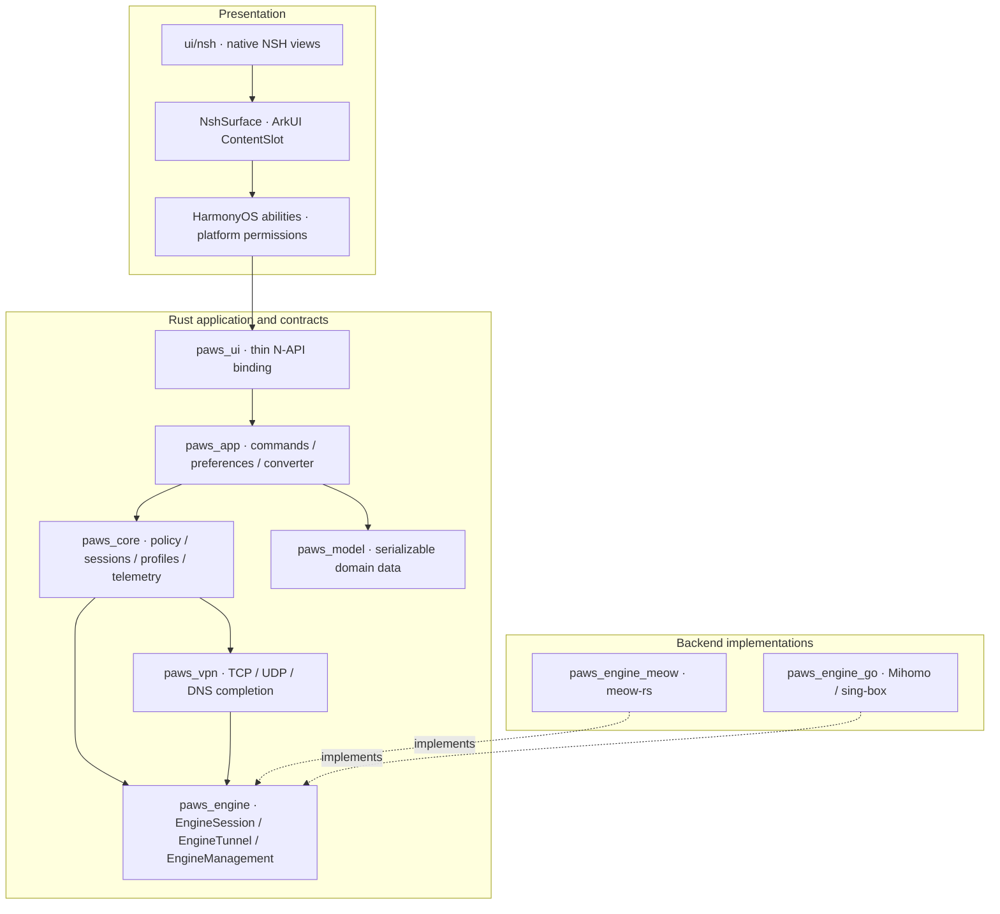

# NSH three-layer architecture

This branch replaces the Arkit/Dioxus application with the locally adapted
NSH OpenHarmony backend. The migration must preserve VPN ownership,
configuration conflict detection, protected networking, profile persistence,
and observable failures.

The presentation uses the local NSH Gallery theme and `nsh/base` controls,
including a full-page YAML `Editor` opened through the navigation stack.
The former Zinc shadcn appearance is removed. Navigation hierarchy, command
contracts and conflict detection still belong to the application. Production
UI ownership, lifecycle invariants and test commands are described in
[the UI guide](../ui/nsh/README.md).

## Ownership

| Owner | Contract |
| --- | --- |
| `ui/nsh` | Own navigation, visual state, localization, adaptive layout and drafts. Query typed domains on demand, subscribe to changes, and submit commands. Never load engines or construct native engine configuration. |
| `NshSurface` host | Own surface disposal, registered component instances and platform actions. Release revision waits on disposal and reject stale component results. |
| `paws_ui` | Bind application/platform operations to N-API. Its historic library name is retained because abilities and debug automation load it. It must contain no renderer or engine FFI. |
| `paws_app` | Validate command payloads, invoke domain operations, persist presentation preferences, and return conditional platform effects. Own subscription conversion. |
| `paws_core` | Own engine policy, session ownership, route qualification, persistence transactions, telemetry and profile/provider orchestration. |
| `paws_profile` | Own source profiles, persisted overrides, rules, imports and backup formats. |
| `paws_model` | Own domain records and errors. It must not depend on engines or UI code. |
| `paws_engine` | Own backend-neutral lifecycle, live management, capability, stream/datagram and platform service interfaces. No concrete backend dependencies are permitted. |
| `paws_vpn` | Own userspace TUN forwarding and DNS completion through `EngineTunnel`. No meow public types may cross this boundary. |
| `paws_engine_meow` | Convert neutral flow metadata to meow types, implement TCP/UDP/DNS access and own native proxy listeners. |
| `paws_engine_go` | Own native dynamic-library handles, C ABI callbacks, engine configuration translation, lifecycle, live controller operations and traffic normalization for both Go engines. |

## Commands and state

The presentation bridge uses `{id, command, payload}`. Responses are
`{id, ok, data, effect?, error?, barrier?, stateRefreshError?}`; every successful operation contains `data`,
including explicit `null`. Unknown commands and invalid payloads fail.
Errors must never be reported as successful empty data.

The aggregate runtime snapshot transport from Core to the UI has been removed.
The host queries fourteen typed domains required by the active page and observes
lightweight change events. Preferences use a separate event, not a fifteenth
runtime domain. Internal configuration/state reads and transaction-consistent
Core snapshots remain valid; they are not a full-snapshot presentation protocol.
Large rule sets, node rosters, logs and configuration contents must not be
copied into unrelated pages or on every telemetry tick. The home page consumes
counts and selected-node summaries; expanded node lists request their data.

Each domain response binds its data and revision under the same state lock.
Observation starts before the initial query so a concurrent update cannot be
lost. The UI retains domain signals and page-owned drafts, rejects stale
responses, and releases page subscriptions when they are no longer needed.
`state.subscribe` atomically replaces the gateway's interest set and always
includes `config` and `status`. Its generation fences requests from departed
pages. `changed` events contain only domain keys and target revisions.
`state.query` reads one subscribed domain; a `proxies` query may name one
`groupKey`. Each key has at most one in-flight query, and repeated invalidations
coalesce to the latest target revision. Retained navigation pages release their
interests while keeping drafts and cached display data.

A successful mutation's `barrier` lists the domain revisions that its caller
must observe before reporting synchronized success. Receipt acknowledgment is
independent, so a pending domain read cannot block Stop or import cancellation.
Stop and recovery wait only for `config` and `status`. If the operation commits
but a subsequent query fails, its original result remains available and the UI
reports a synchronization warning. Retrying state queries never replays the
mutation. Query failures expose an explicit retry action.

Configuration revisions and VPN session ownership remain transaction fences;
removing aggregate presentation transport does not remove those guarantees.
Revisions above JavaScript's safe integer range are passed as decimal strings
at command boundaries.

The application returns `start`, `stop` or `restart` platform effects rather
than acquiring HarmonyOS permissions itself. Configuration follow-ups carry
the previous session owner and the committed configuration revision. The host
must check both before restarting/stopping. A replaced session must never be
stopped by a late save, refresh, import or delete result.
If no session existed when a command began, its committed update may bind the
first session observed at completion. This covers a cold-start subscription
refresh that finishes after the user connects. The host still checks that
owner and revision immediately before applying the effect.
Mode changes use the same conditional reconfiguration path: sing-box compiles
mode-dependent rules, so updating a presentation flag alone cannot change its
running route policy. Editing an inactive profile or restoring inactive backup
copies does not request a restart of the active profile.
An explicit user Stop claims the current owner through the platform intent
queue and is not conditional on a configuration revision. A concurrent save
must not cancel Stop; the intent fence still prevents it from stopping a later
explicit Start. Automatic stop/restart effects retain both ownership checks.

## Engine lifecycle

The VPN ability follows one path for all engines:

1. Bind the exact start attempt and install process-network protection.
2. Ask Rust to resolve policy and prepare an opaque engine plan.
3. Create the platform TUN and pass its borrowed descriptor to `startEngine`.
4. The selected adapter starts, reports actual readiness, and participates in
   the existing startup route/health checks.
5. Poll normalized traffic independently from bounded, interest-driven runtime
   observations and process shared configuration updates.
6. Stop the same owner, clean up its engine and TUN, then complete the attempt.

Adapters must duplicate borrowed descriptors before taking ownership. A failed
start must release partial resources. Unsupported operations are typed errors,
not fabricated success. Backend process-identity queries use a platform port;
missing or failed queries remain unknown. Callback execution must not block
the JavaScript thread waiting for itself.

Backend selection and protocol fallback remain observable through the existing
engine decision/qualification records. A user's preference cannot bypass the
route validation required before Connected is shown.

Live management must target the active engine. A failed controller request must
never fall back to changing a shadow meow runtime and report success. Each
adapter declares only the operations it actually implements; unsupported
operations remain typed failures. Delayed telemetry results must be checked
against the session that produced them before publication.

The middle layer may retain a compiled configuration for shared rule preview,
profile validation and desired-state policy. Such preview data is distinct
from live connections, DNS state and route proof. Profile transactions and
policy stay in the middle layer; engine listeners and network execution stay
in adapters.

## Capability and validation limits

Shared profile, preferences and platform functions do not require duplicate
backend implementations. Engine actions must reach the current real owner;
capability declarations, cached configuration and management HTTP success are
not proofs of TUN routing or full three-engine equivalence. Unsupported syntax
or fields must fail explicitly. Stack choice applies to Meow; Go engines use
their native stacks. Public MTU is integer 1280..65535 and requires a new
platform/native TUN attempt when changed.

Host traces and worker timings do not prove native pixels, IME, clipboard,
rendered frames or overall performance. Compact Settings' changed physical
geometry/details acceptance remains pending. Ordinary text still has bounded
raster memory; viewport editing and bounded error details do not make arbitrary
logs or long paragraphs safe. Preserve full source and visible errors, and never
infer an unknown native query cause from successful fault-injection rendering.
Device automation must pause during user-controlled manual interaction.

## Local dependency and verification policy

Build NSH and its matching Ability packages from the local adapted checkout.
Stage build outputs under Paws; never mutate or reset the user's NSH checkout.
Record the NSH revision in build metadata. Packaging must verify the NSH native
library, the application binding, both Go engines and the actual UI bundle.

Acceptance must cover Rust domain tests, real NSH bundling, platform lifecycle
tests, dependency boundaries, OHOS native linking and HAP packaging. A device
smoke result is separate from a successful build. If no device is available,
record that limitation explicitly. The final audit must disclose any remaining
backend-specific management coupling in `paws_core`; a lifecycle/data-plane
port alone does not prove that the entire management plane is neutral.
